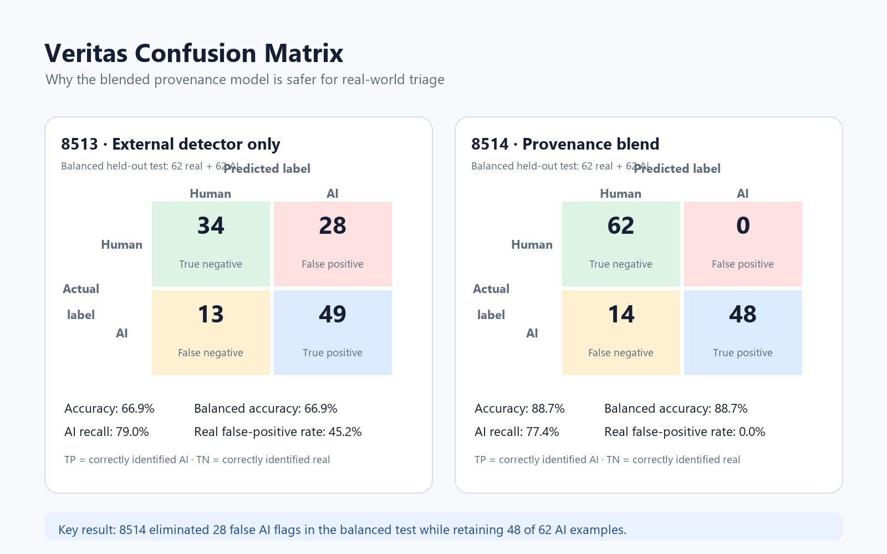

# Veritas

Veritas is an explainable media-triage prototype that combines a pretrained
ConvNeXt visual detector with Benford leading-digit drift and claimed camera
metadata evidence. It reports a six-tier assessment rather than presenting
the result as proof of an image's origin.

## What it does

- Accepts PNG, JPG/JPEG, HEIC, and HEIF image uploads.
- Uses a pretrained visual detector as the primary signal.
- Adds small, explainable adjustments from Benford MAD and EXIF camera metadata.
- Displays the evidence behind the final assessment.

## Run locally

Use Python **3.11** for the deployment-compatible environment.

```powershell
python -m pip install -r requirements.txt
streamlit run app_provenance_blend.py
```

## Streamlit Community Cloud deployment

Deploy `ryanyu808/veritas-forensics`, branch `main`, with entry point
`app_provenance_blend.py`. In **Advanced settings**, explicitly select
**Python 3.11** and use the custom subdomain `veritas-forensics-808`.

For an existing deployment using Python 3.14, changing `requirements.txt` or
rebooting does not change the Python interpreter. Follow Streamlit's
[Python version change instructions](https://docs.streamlit.io/deploy/streamlit-community-cloud/manage-your-app/upgrade-python):
save the existing subdomain and any secrets, delete the Cloud app, then redeploy
the same repository, branch, entry point, and subdomain with Python 3.11 selected
in Advanced settings. Restore any secrets during redeployment. This retains
the public address `https://veritas-forensics-808.streamlit.app/`.

`requirements.txt` pins Streamlit 1.40.2, the patch release in the earliest
release family supporting the existing `st.image(use_container_width=True)`
UI. Streamlit 1.22.0 imports `imghdr`, which Python removed in 3.13; it also
lacks the image-width and container-border APIs used here. Python 3.11 alone
therefore does not make Streamlit 1.22.0 sufficient for this application.
No `imghdr` shim or application code change is needed. The AI dependencies,
checkpoint, preprocessing, scoring rules, and UI code are unchanged.

There is no repository `.streamlit/config.toml`; Streamlit's defaults apply.
Select Python in the Cloud deployment dialog; a Streamlit TOML setting cannot
choose the interpreter. After deployment, confirm the logs report Python 3.11
and Streamlit 1.40.2, then upload an image and run a scan.

The external model checkpoint is intentionally not included in this repository
because it is approximately 1 GB. When the local checkpoint is present, the
app uses it from:

```text
external_models/xrayon/AI Images Detector/checkpoints/checkpoint_phase2.pth
```

When that file is absent, the app downloads it automatically from the official
public [xRayon ConvNeXt AI Images Detector model repository](https://huggingface.co/xRayon/convnext-ai-images-detector)
and caches it for the running environment. The model repository identifies the
checkpoint as MIT-licensed; retain that attribution when redistributing the
prototype. The first cloud scan can take longer because the checkpoint is
approximately 1 GB.

## Important limitation

Veritas is an evidence-based triage assistant. Its assessments are not
calibrated probabilities and do not prove whether an image is AI-generated or
human-made. EXIF metadata can be missing, edited, or copied.

## Benchmark snapshot

On a balanced held-out set of 62 real camera images and 62 confirmed AI images,
the provenance-blend policy reached 88.7% balanced accuracy, with 77.4% AI
recall and 0.0% real-image false-positive rate. This is a prototype benchmark,
not a claim of universal performance.

The benchmark graphic below compares the external-only detector with the
provenance blend using clearly separated predicted-label headings.



[Open the full-size confusion matrix](./confusion_matrix_comparison.png)
